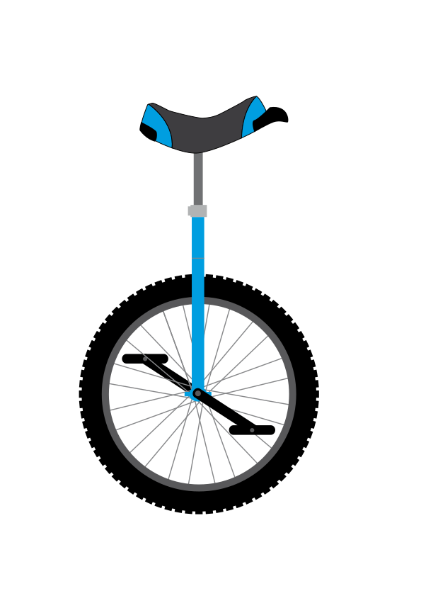

<p align="center">
  
</p>

# UniSQL

Write SQL in one dialect; get it back in another. Pronounced "unicycle".

**Status: pre-release (0.16.x), published to crates.io** (all six crates at 0.16.3, read back
2026-10-14). Pre-1.0: the second number is the breaking one, and `CHANGELOG.md` states what each
version flips for a consumer. `cargo add unisql`. The release work is recorded in `docs/PUBLISHING.md`.

```rust
use unisql::{translate, Options};

let t = translate("SELECT id FROM users WHERE id = $1", "postgres", "sqlite", &Options::default())?;
assert_eq!(t.sql, r#"SELECT "id" FROM "users" WHERE "id" = ?1"#);
// t.report says, per construct, whether the target gave it exactly, by emulation, or conditionally.
// t.param_order / t.param_bindings say how the caller must bind each parameter on the target
// (for example an array parameter becomes JSON text on SQLite and MySQL).
```

To learn what a statement needs *without choosing a target* (for a gate that derives a program's needs
from its statement catalogue):

```rust
let a = unisql::analyse("SELECT CAST(name AS UUID) FROM users", "postgres")?;
assert!(a.constructs.contains("cast.to_uuid"));     // the leaf ids the matrix files use
assert!(a.refused.contains("cast.to_uuid"));        // this form is refused by some target
```

`constructs` come from the IR alone; `refused` is the set of leaf ids some registered target refuses,
with every allowance granted (each is also in `constructs`). A target stops at its first refusal, so a statement with
two refused forms reports one per target. `unreadable` names a construct outside the IR.

What it does and does not promise, in one paragraph: a statement is translated only when the target
can give it the source's meaning. Where it is the same only under an assumption (text collation,
`now()` as text, lenient casts), you must name that assumption in `Options`, or you get an error and
**no text**. Where no equivalent exists, you get an error naming the construct and what to do
instead. There is no best-effort mode.

- `docs/DESIGN.md`: scope, approach, tiers, decisions.
- `docs/MEASUREMENT.md`: how much of three real codebases' SQL translates (rule-table counts).
- `docs/DIFFERENTIAL-postgres-sqlite.txt`: the latest differential run against real engines.
- `docs/LICENCES.md`: licences of the projects we learn from, read from their files.
- `docs/PUBLISHING.md`: the publish checklist and its findings (nothing is published).
- `ROADMAP.md` and `CHANGELOG.md`: what is next, and what each version changed.

## Layout

| Crate | Role |
|---|---|
| `unisql` | the `translate` entry point; the only crate most callers need |
| `unisql-core` | the IR, tiers, report, shared printer; knows no dialect |
| `unisql-sqlparser-adapter` | sqlparser AST -> IR, parameterised by per-dialect rules (replaceable) |
| `unisql-dialect-postgres` | PostgreSQL reader and target (+ `matrix-postgres-from-*.tsv`) |
| `unisql-dialect-sqlite` | SQLite reader and target (+ `matrix-sqlite-from-*.tsv`) |
| `unisql-dialect-mysql` | MySQL and MariaDB reader and target (+ `matrix-{mysql,mariadb}-from-*.tsv`) |
| `unisql-macro-core` | the checks and translation behind the compile-time macros (`docs/MACROS.md`); not yet published |
| `unisql-embed` | what the macros expand to: per-target SQL as `&'static` data, no dependencies; not yet published |
| `unisql-macros` | `sql!`: check and translate a literal statement for named targets at build time (`docs/MACROS.md`); not yet published |
| `unisql-differential` | tests that run the real engines and compare results; corpus runner |

Dialects today: sources and targets `postgres`, `sqlite`, `mysql`, `mariadb`. Seven directions are
tested against real engines: postgres->sqlite, sqlite->postgres, postgres->mysql, postgres->mariadb,
mysql->postgres, mysql->sqlite, mariadb->postgres.
Each dialect module ships matrix files in PersistAnt's row schema (`subject_kind, subject, backend,
version, config, enabled, reason, metadata, note, from`), generated by its differential suites. A row
is a **leaf id** and a fact a test established:

- `enabled=yes`: the leaf translated and matched the real engines (`tier=native|emulated` in
  `metadata`). A divergence a caller may accept is its own leaf `<construct>.<allowance>`
  (`tier=conditional`, `allowance=` first in `note`); the strict leaf is then `enabled=no,
  reason=wrong`, unless the only divergence is the text collation and a known-bad control shows
  that a different collation really diverges, in which case the strict leaf is `yes` under
  `config=collation=utf8mb4_bin` and the control's collation has its own `no/wrong` row.
- `enabled=no, reason=missing`: the translator refuses the form (`cast.to_uuid`, `fn:md5`).
- No row means untested, which is off. `config` is what the fixture engines ran under and ends
  `schema=none`: every row is computed from syntax alone, without a caller `Schema`.

`docs/LEAF-CONTRACTS.tsv` holds each leaf's written contract (a test checks that every leaf in a
matrix file has one). `unisql::analyse` returns the same ids a statement needs, including the
partial forms (`cast.to_uuid`, `upsert.no_conflict_key`, `returning.update`, `trim.multi_char`,
`fn:<agg>.order_by`, `distinct_on.star_projection`), so a gate that looks only at `constructs`
cannot let a refused form through.

## Running the differential tests

They need real engines and fail (never skip) if one is unreachable:

```
docker run -d --name unisql-pg -e POSTGRES_PASSWORD=unisql   -e POSTGRES_INITDB_ARGS="--locale=C --encoding=UTF8" -p 127.0.0.1:55432:5432 postgres:16
docker run -d --name unisql-mysql -e MYSQL_ROOT_PASSWORD=unisql -e MYSQL_DATABASE=uni   -p 127.0.0.1:53306:3306 mysql:8.4 --character-set-server=utf8mb4 --collation-server=utf8mb4_bin
docker run -d --name unisql-mariadb -e MARIADB_ROOT_PASSWORD=unisql -e MARIADB_DATABASE=uni   -p 127.0.0.1:53307:3306 mariadb:11.4 --character-set-server=utf8mb4 --collation-server=utf8mb4_bin
cargo test -p unisql-differential
```

`UNISQL_PG_URL`, `UNISQL_MYSQL_URL` and `UNISQL_MARIADB_URL` override the connection strings. The
collations are not incidental: PostgreSQL's `C` locale and MySQL's `utf8mb4_bin` are what make text
ordering and equality agree, which is the premise of the `text_collation` allowance. Versions the
last run used: PostgreSQL 16.15, SQLite 3.53.2 (bundled), MySQL 8.4.11
(`sha256:6ea90827b1100f8f2ae306a539f86d2c264a26ed435a2a9f75551dd5c3aeb242`), MariaDB 11.4.13
(`sha256:1292844148b311e4ed4300022a996d39083f415a963e970cf47cad1b3b18e3a6`).

## Licence

`MIT OR Apache-2.0` for the code. The logo in `assets/` is "Unicycle" by GDJ from
[Openclipart](https://openclipart.org/detail/221146/unicycle) (public domain per the site; see
`docs/LICENCES.md`).
